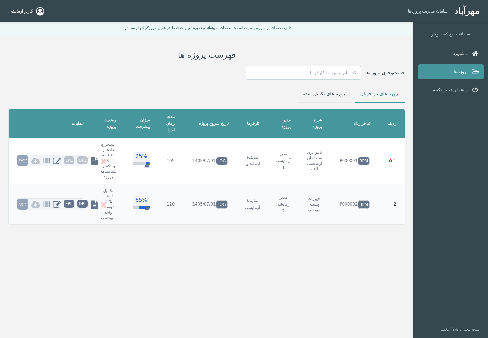

# سورس دریافتی مهرآباد — 14031117

بستهٔ اشتباه قبلی و تاریخچهٔ آن از شاخهٔ `main` حذف شده‌اند. آرشیو `14031117.rar` و فایل‌های استخراج‌شدهٔ آن بدون تغییر نگهداری می‌شوند. ابزار اجرای محلی زیر جداگانه بر اساس دو قالب نسخهٔ جدید `bin.rar` ساخته شده است.

## اجرای رابط محلی برای بررسی دکمه‌ها

[دانلود بستهٔ مستقل local-ui](mehrabad-local-ui.zip) · [راهنمای فارسی](local-ui/README_FA.md) · [نتایج آزمایش](local-ui/VALIDATION_FA.md)

پوشهٔ `local-ui` را در `TEST` کنار `Apache24` و `php` استخراج کنید و روی **START_LOCAL.cmd** دوبار کلیک کنید. داشبورد، فهرست پروژه‌ها و شناسنامهٔ هر پروژه با دادهٔ آزمایشی قابل بررسی است. فهرست و شناسنامه از قالب‌های PHP دریافتی رندر می‌شوند. ذخیره فقط پیش‌نویس محلی مرورگر است؛ دیتابیس و گردش کار واقعی فعال نیستند.

فایل‌های ظاهر اصلی از پوشهٔ سایت موجود روی سیستم شما خوانده می‌شوند؛ در نبود آن‌ها نسخهٔ جایگزین همراه بسته استفاده می‌شود. سربرگ، منو و داشبورد محلی‌اند و تطابق کامل با سایت اصلی ادعا نشده است. لانچر ویندوز در محیط لینوکس قابل آزمایش نبوده؛ صفحات با PHP 8.4 و Chromium آزمایش شده‌اند.

## محتوای مخزن

| مسیر | توضیح |
| --- | --- |
| [14031117.rar](14031117.rar) | فایل RAR اصلی، بدون تغییر |
| [14031117/](14031117/) | تمام ۱۶۸ فایل استخراج‌شده، بدون تغییر |
| [AUDIT_FA.md](AUDIT_FA.md) | گزارش بررسی، موانع اجرا و متن درخواست فایل‌های مفقود |
| [audit/](audit/) | اثر انگشت فایل‌ها، نتیجهٔ بررسی نحوی JavaScript و فهرست وابستگی‌های مفقود |

## آیا آرشیو اصلی 14031117 به‌تنهایی سایت عملیاتی است؟

**خیر.** این آرشیو ۱۴۲ فایل PHP و ۲۶ فایل JavaScript دارد، اما فایل ورودی، مسیریاب، autoload و پوشهٔ `System` در آن نیست. دیتابیس SQL Server، پیکربندی و فایل‌های اصلی CSS، تصاویر، فونت‌ها و کتابخانه‌های رابط کاربری هم همراه آن نیستند. نصب XAMPP یا اجرای `php -S` این کمبودها را برطرف نمی‌کند.

می‌توانید پوشهٔ `14031117` را در VS Code برای بررسی کد باز کنید؛ این کار سایت عملیاتی را اجرا نمی‌کند. مسیر اولیهٔ بررسی دکمه‌ها `14031117/app/views/` است.

بررسی نحوی هر ۲۶ فایل JavaScript موفق بود. اجرای PHP، نمایش واقعی صفحات، ورود و عملیات دیتابیس به دلیل کمبودهای توضیح‌داده‌شده تأیید نشده است.

جزئیات و متن قابل ارسال برای تحویل‌دهنده در [گزارش فارسی](AUDIT_FA.md) موجود است.
